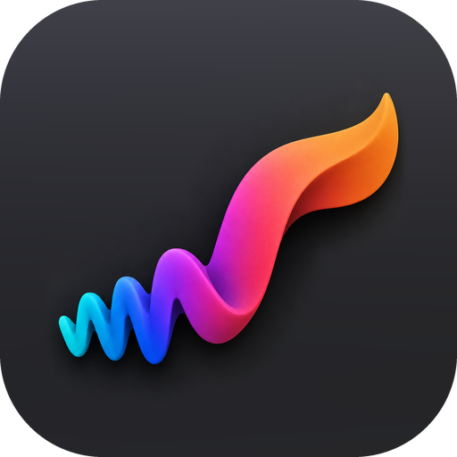
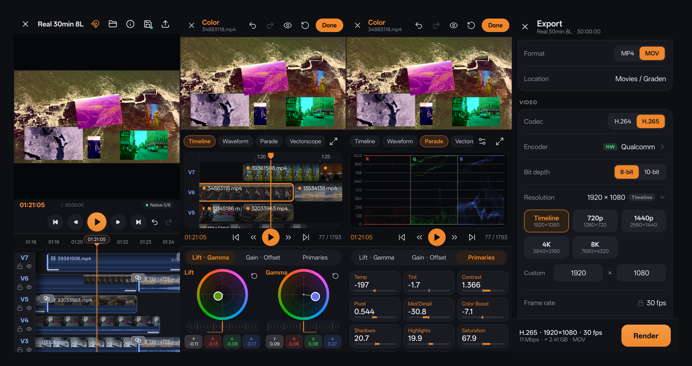
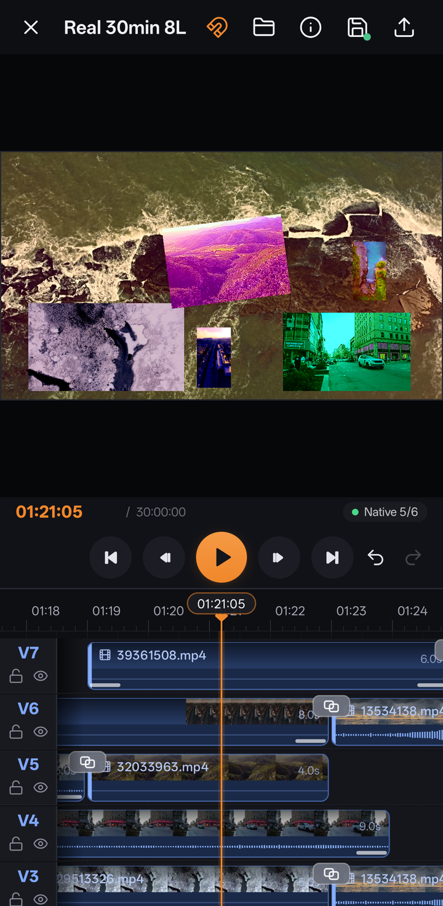
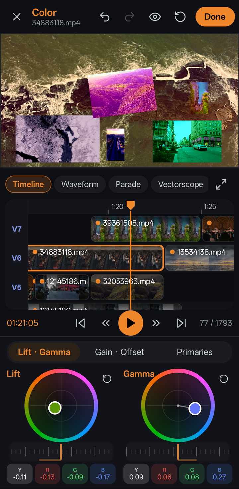
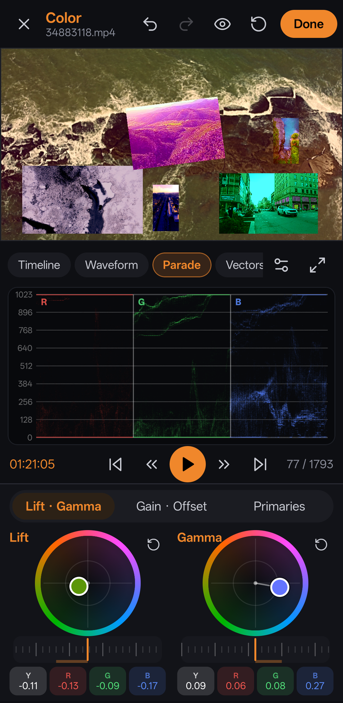
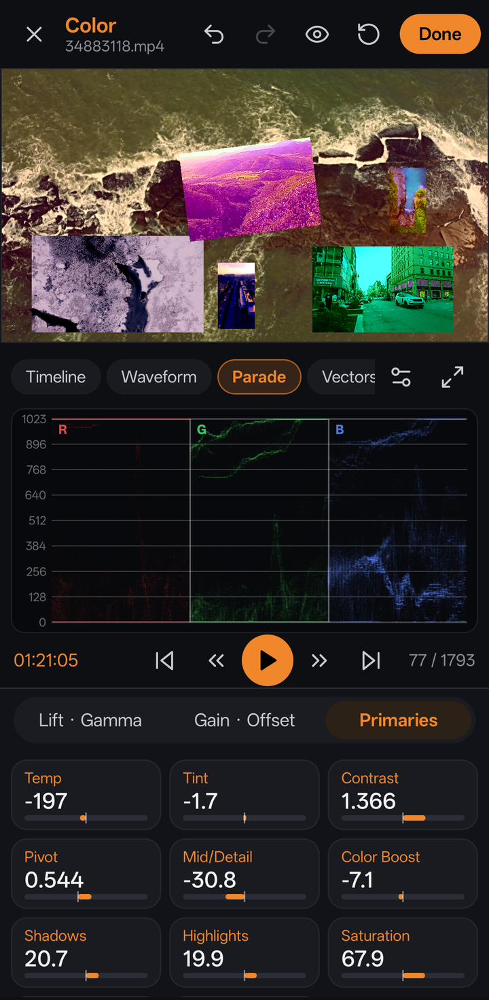
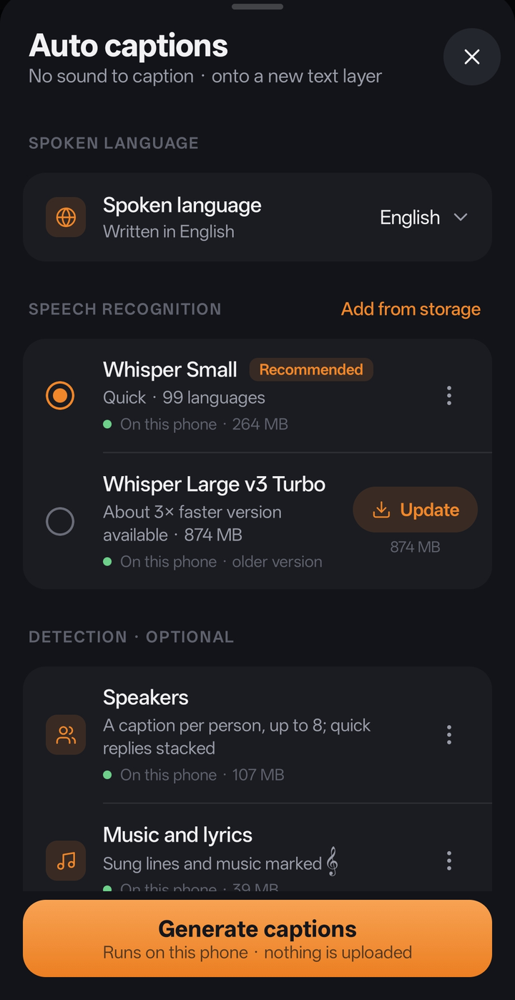
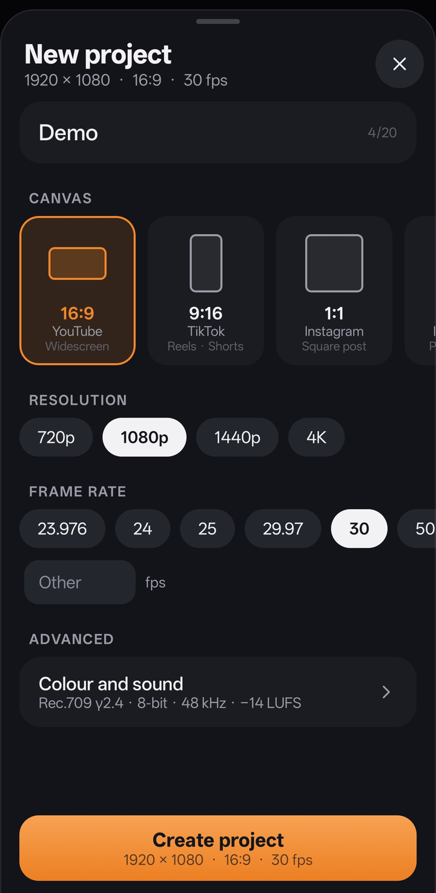
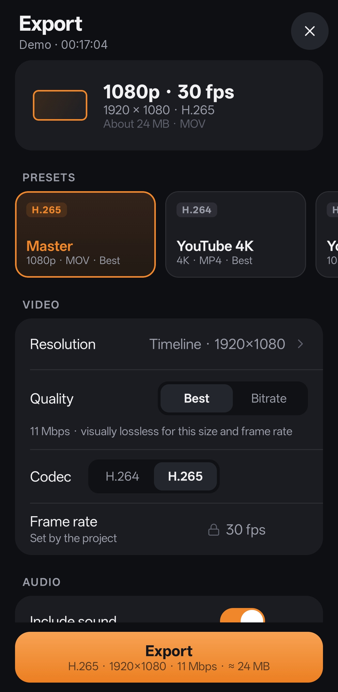

<div align="center">



# Graden

**A multi-layer video editor and colour grading app for Android, built for real footage.**

[](https://github.com/Pixelgamer4k/graden/releases)
[](#install)
[](LICENSE)



</div>

> [!NOTE]
> **This is a beta.** Things will break and some screens will change. Your feedback decides what gets fixed and built
> next: please [report bugs and ideas](https://github.com/Pixelgamer4k/graden/issues/new/choose).

## Highlights

**New in 0.3: captions and text**
- **Auto captions** made on the phone with Whisper (Small or Large v3 Turbo, 99 languages): sentence by sentence, timed
  to the word, laid out like YouTube and Netflix subtitles, on a layer of their own; for the whole project or one clip
- **Speakers**: an optional model (NVIDIA Nemotron 3 Diarization) gives each person their own captions, and stacks quick
  replies as two lines
- **Music and lyrics**: an optional sound classifier (CED) marks sung lines with 𝄞 and music alone as 𝄞
- Models are downloaded inside the app from their official sources (checked against their checksums) or added from
  storage; nothing is uploaded
- **Text and titles**: 28 built-in fonts (including Hindi and Bengali), colour, outline, shadow, background box,
  decorations, spacing, and **14 in and out animations**; drag a text on the picture to move it, pinch to resize,
  twist to turn
- Ready-made text styles (titles, lower thirds, social, script and more) in the media box, to tap or drag in
- Captions stay marked as captions however much they are edited, ready for exporting them separately later

**A redesigned media box, project setup and export**
- Media sorted into All, Video, Text, Images, GIFs, Audio and MCRAW, ordered newest first (or by name, size or
  length), with the files of your other projects there to use too
- New project: shape, size and frame rate up front; colour spaces, bit depth, sample rate and loudness under
  Advanced (Rec.709 by default)
- Export: a summary of what will be written, presets, then video, audio and file; encoder and colour under Advanced

**Editing**
- As many picture and sound lanes as you need, tested with **8 layers of 4K footage and 1,800 clips** on one timeline
- Smooth scrubbing, playback and pinch-zoom on long projects, with filmstrip thumbnails on every clip
- Trim, split, move, crop, flip, rotate and place pictures anywhere on the canvas
- Speed changes (pitch kept) and reverse
- **46 transitions and animations**: fades, slides, pushes, wipes, zooms, spins and motion
- Per-clip sound: volume, fades, pan, 3-band EQ, pitch and peak normalising

**Proxies, done properly**
- Light editing proxies are made automatically in the background, so 4K and high-bitrate files edit smoothly
- When you stop, the preview shows the **original file's exact frame at full resolution**, on every layer

**Stabilisation**
- A **visual gyro** built from scratch: it measures the camera's rotation and zoom from the picture itself, row by row
  (rolling shutter included), and works out the lens on its own, so it needs no gyro data
- Choose what to hold steadiest (background, balanced or subject), with smoothing, strength and framing controls
- Natural motion is kept; shake and jitter go, with the least crop that does it
- **3D camera view**: a modelled camera moves exactly as the visual gyro measured, at its real size of motion; switch
  to *Stabilized* to watch the same camera move on the smoothed path
- Analyse first, at the resolution you choose (480p to 4K), and see the analysis and stabilised render speed while exporting

**Colour management, matched to DaVinci Resolve**
- Colour Space Transform with **28 camera and display curves** and **20+ gamuts** (ARRI, Sony, Canon, Panasonic, RED,
  Blackmagic, Fujifilm, Nikon, DJI, Apple Log, ACES, DaVinci Wide Gamut, Rec.709/2020, P3…)
- **DaVinci tone mapping**, Saturation Compression gamut mapping and HDR ↔ SDR conversion, measured against Resolve 21
  itself and matched to within about one 10-bit code value
- HDR projects and **HDR10 / HLG export**, with the HDR metadata written into the file

**RAW**
- MotionCam RAW (`.mcraw`) recordings: white balance, exposure, ISO, highlight recovery, black and white level,
  tone and detail, developed live from the sensor data

**Colour**
- Lift, Gamma, Gain and Offset wheels, each with separate Y / R / G / B controls
- Primaries: temperature, tint, contrast (S-curve, as Resolve), pivot, mid-detail, colour boost, shadows, highlights, saturation, hue, lum mix
- Scopes: waveform, RGB parade, vectorscope, histogram and CIE chromaticity, with Resolve-style options
- A touch-sized mini timeline for jumping between clips, and grouping to grade several clips at once
- Haptic steps, detents at neutral, and protection against accidental touches

**Export**
- H.264 and H.265 with the phone's **hardware encoders**, MP4 or MOV
- Rendered from the **original files at full quality**: no proxies, no hidden downscaling
- Any resolution the encoder supports (up to 8K), **10-bit** H.265 where the phone supports it
- HDR drawn straight from the GPU into the encoder: about **3× faster** HDR export than 0.1
- "Best" quality never goes below the footage's own bitrate
- Automatic "Best" bitrate, or your own bitrate, VBR or CBR, profiles and keyframe interval
- AAC audio up to 320 kbps with optional EBU R128 loudness normalising
- Presets (Master, YouTube 4K, YouTube 1080p, Reel) and your own saved presets
- Runs in the background with a progress notification

## Screenshots

| Editor | Colour: timeline | Colour: scopes | Colour: primaries |
|:-:|:-:|:-:|:-:|
|  |  |  |  |

| Auto captions | New project | Export |
|:-:|:-:|:-:|
|  |  |  |

## Tested on real devices

The video pipeline was tested on **9 Samsung phones and tablets** through Samsung Remote Test Lab: Exynos 2400, 2500
and 2600, Snapdragon 750G, 8 Gen 2, 8 Elite and 8 Elite Gen 5, and Dimensity 9300+ and 9400+. Every export ran on the
hardware encoder. The results and the fixes they led to are in [docs/TESTING.md](docs/TESTING.md).

## Install

1. Download **`Graden-0.3.4-beta.apk`** from the [latest release](https://github.com/Pixelgamer4k/graden/releases).
2. Open it on your phone and allow installing from this source when Android asks.

Needs **Android 10 or newer**. A recent phone with a capable chip gives the best experience with 4K footage.

## Roadmap

See what's available now and what's coming, from beat sync and motion tracking to smooth slow motion: **[the Graden roadmap](ROADMAP.md)**.

## Feedback

This beta exists to collect feedback, so every report helps:

- 🐞 **Bugs**: [open a bug report](https://github.com/Pixelgamer4k/graden/issues/new?template=bug_report.yml), with your phone model and, if you can, a screen recording
- 💡 **Ideas**: [suggest a feature](https://github.com/Pixelgamer4k/graden/issues/new?template=feature_request.yml)
- 💬 **Questions and general thoughts**: [Discussions](https://github.com/Pixelgamer4k/graden/discussions)

## Known limitations in 0.3

- Exporting many layers of 4K footage is slow: rendering is done at full quality, frame by frame
- 10-bit and HDR export depend on the phone's encoder; where it cannot, the export screen says so
- The colour wheels follow Resolve's manual but are not yet measured against Resolve the way the colour space
  transform is
- 0.3.4 is signed with the same key as earlier betas, so it installs over them and keeps your projects
- Captions need a 64-bit ARM phone; speaker and music detection need one from about 2019 on (ARMv8.2)
- GIFs are shown as still pictures for now
- Captions are drawn into the video; exporting them as a separate subtitle file is planned
- Software encoders (x264 / x265) are built in but switched off in this beta (see below)
- Projects and media are stored inside the app; uninstalling removes them

## Build from source

Requirements: Android Studio (or JDK 17 and the Android SDK), with the Android NDK and CMake.

```bash
git clone https://github.com/Pixelgamer4k/graden.git
cd graden
./scripts/fetch-opencv.sh
./gradlew assembleDebug
```

`fetch-opencv.sh` downloads the OpenCV 4.10 Android SDK (Apache-2.0, checked by its SHA-256) and keeps the parts the
visual gyro uses.

The APK is written to `app/build/outputs/apk/debug/`.

**Optional software encoders.** Graden can include x264 and x265 for software H.264 / H.265 encoding (any resolution,
CRF, 10-bit on any phone). They are off by default. To build them, install the Android NDK and CMake, then:

```bash
./scripts/build-codecs.sh
./gradlew assembleDebug -Psoftenc=true
```

and set `SOFTWARE_ENCODERS = true` in `app/src/main/java/com/graden/editor/export/ExportModels.kt`.

## Built with

Kotlin · Jetpack Compose · AndroidX Media3 · OpenGL ES · MediaCodec ·
[OpenCV](https://opencv.org/) (Apache-2.0) · the [MotionCam](https://github.com/mirsadm/motioncam-decoder) decoder
(Apache-2.0) · [nlohmann/json](https://github.com/nlohmann/json) and [SIMDe](https://github.com/simd-everywhere/simde)
(MIT) · [whisper.cpp](https://github.com/ggml-org/whisper.cpp) (MIT) with OpenAI's Whisper models and Silero VAD (MIT) ·
[audio.cpp](https://github.com/0xShug0/audio.cpp) (Apache-2.0) running NVIDIA Nemotron 3 Diarization (OpenMDW-1.1) and
CED (Apache-2.0); its library is built by `tools/audiocpp/build.sh` · fonts from [Google Fonts](https://fonts.google.com/)
under the SIL Open Font License or Apache-2.0 (licences in `app/src/main/assets/fonts/licenses`), and optionally
[x264](https://www.videolan.org/developers/x264.html) and [x265](https://www.x265.org/).

Footage in the screenshots is from [Pexels](https://www.pexels.com/), used under the Pexels license.

## License

Graden is free software, released under the [GNU General Public License v3.0](LICENSE).

Made by **Pixelgamer4k**.
