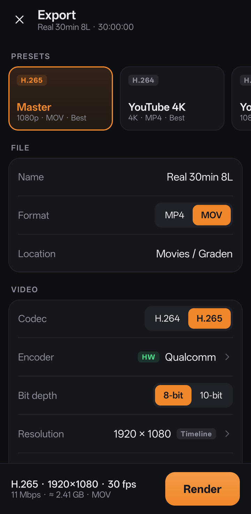
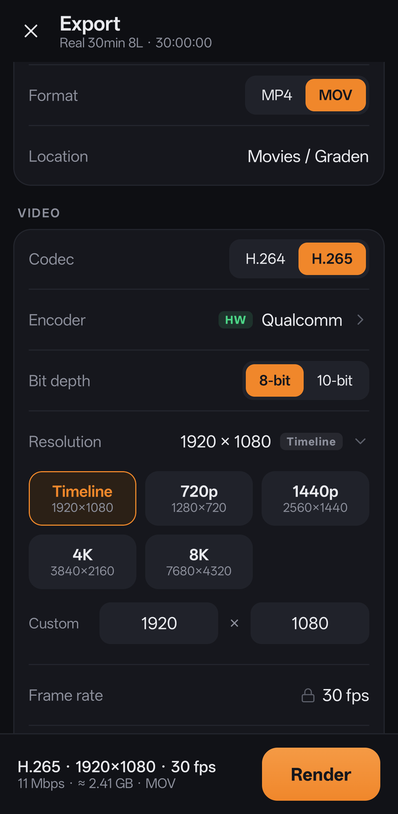

<div align="center">

# Graden

**A multi-layer video editor and colour grading app for Android, built for real footage.**

[](https://github.com/Pixelgamer4k/graden/releases)
[](#install)
[](LICENSE)


</div>

> [!NOTE]
> **This is a beta.** Things will break and some screens will change. Your feedback decides what gets fixed and built
> next: please [report bugs and ideas](https://github.com/Pixelgamer4k/graden/issues/new/choose).

## Highlights

**Editing**
- As many picture and sound lanes as you need, tested with **8 layers of 4K footage and 1,800 clips** on one timeline
- Smooth scrubbing, playback and pinch-zoom on long projects, with filmstrip thumbnails on every clip
- Trim, split, move, crop, flip, rotate and place pictures anywhere on the canvas
- Speed changes (pitch kept) and reverse
- **46 transitions and animations**: fades, slides, pushes, wipes, zooms, spins and motion
- Per-clip sound: volume, fades, pan, 3-band EQ, pitch and peak normalising

**Proxies, done properly**
- Light editing proxies are made automatically in the background, so 4K and high-bitrate files edit smoothly
- When you stop, the preview shows the **original file's exact frame at full resolution**, on every layer

**Colour**
- Lift, Gamma, Gain and Offset wheels, each with separate Y / R / G / B controls
- Primaries: temperature, tint, contrast, pivot, mid-detail, colour boost, shadows, highlights, saturation, hue, lum mix
- Scopes: waveform, RGB parade, vectorscope, histogram and CIE chromaticity, with Resolve-style options
- A touch-sized mini timeline for jumping between clips, and grouping to grade several clips at once
- Haptic steps, detents at neutral, and protection against accidental touches

**Export**
- H.264 and H.265 with the phone's **hardware encoders**, MP4 or MOV
- Rendered from the **original files at full quality**: no proxies, no hidden downscaling
- Any resolution the encoder supports (up to 8K), **10-bit** H.265 where the phone supports it
- Automatic "Best" bitrate, or your own bitrate, VBR or CBR, profiles and keyframe interval
- AAC audio up to 320 kbps with optional EBU R128 loudness normalising
- Presets (Master, YouTube 4K, YouTube 1080p, Reel) and your own saved presets
- Runs in the background with a progress notification

## Screenshots

| Editor | Colour: timeline | Colour: scopes | Colour: primaries |
|:-:|:-:|:-:|:-:|
|  |  |  |  |

| Export settings | Resolution |
|:-:|:-:|
|  |  |

## Install

1. Download **`Graden-0.1.0-beta.apk`** from the [latest release](https://github.com/Pixelgamer4k/graden/releases).
2. Open it on your phone and allow installing from this source when Android asks.

Needs **Android 10 or newer**. A recent phone with a capable chip gives the best experience with 4K footage.

## Feedback

This beta exists to collect feedback, so every report helps:

- 🐞 **Bugs**: [open a bug report](https://github.com/Pixelgamer4k/graden/issues/new?template=bug_report.yml), with your phone model and, if you can, a screen recording
- 💡 **Ideas**: [suggest a feature](https://github.com/Pixelgamer4k/graden/issues/new?template=feature_request.yml)
- 💬 **Questions and general thoughts**: [Discussions](https://github.com/Pixelgamer4k/graden/discussions)

## Known limitations in 0.1

- Exporting many layers of 4K footage is slow: rendering is done at full quality, frame by frame
- 10-bit export depends on the phone's encoder; it is only offered where it works
- Software encoders (x264 / x265) are built in but switched off in this beta (see below)
- Projects and media are stored inside the app; uninstalling removes them

## Build from source

Requirements: Android Studio (or JDK 17 and the Android SDK).

```bash
git clone https://github.com/Pixelgamer4k/graden.git
cd graden
./gradlew assembleDebug
```

The APK is written to `app/build/outputs/apk/debug/`.

**Optional software encoders.** Graden can include x264 and x265 for software H.264 / H.265 encoding (any resolution,
CRF, 10-bit on any phone). They are off by default. To build them, install the Android NDK and CMake, then:

```bash
./scripts/build-codecs.sh
./gradlew assembleDebug -Psoftenc=true
```

and set `SOFTWARE_ENCODERS = true` in `app/src/main/java/com/graden/editor/export/ExportModels.kt`.

## Built with

Kotlin · Jetpack Compose · AndroidX Media3 · OpenGL ES · MediaCodec, and optionally
[x264](https://www.videolan.org/developers/x264.html) and [x265](https://www.x265.org/).

Footage in the screenshots is from [Pexels](https://www.pexels.com/), used under the Pexels license.

## License

Graden is free software, released under the [GNU General Public License v3.0](LICENSE).

Made by **Pixelgamer4k**.
